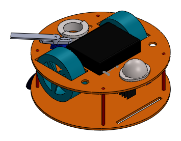
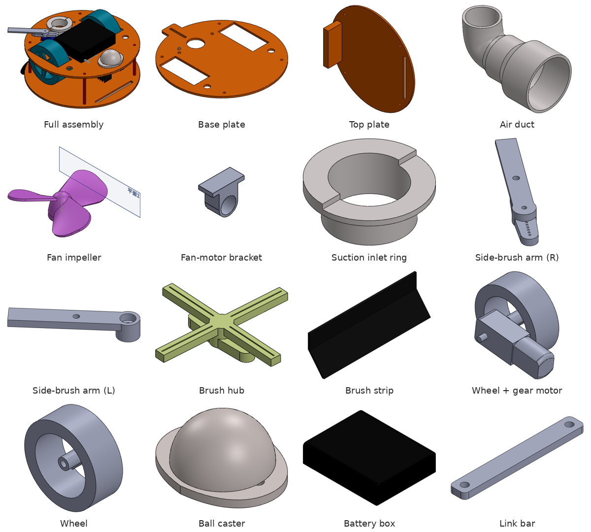
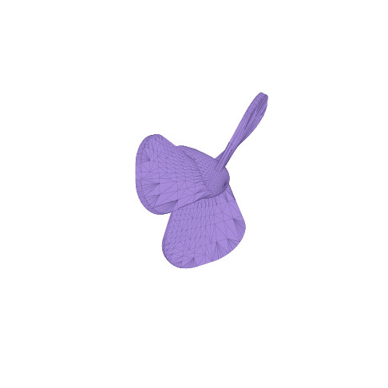

# Remote-Control Vacuum Cleaning Robot (CAD)

SolidWorks design of a teleoperated vacuum-cleaning robot, built as the project for the *Mechatronics* course at National Taiwan University (Sep 2023 - Feb 2024). I was the project leader and modeled the whole robot around the vacuum module.

## The robot

- Two stacked round plates carry a drive module on each side, a ball caster, the fan and air duct of the vacuum module, and the battery.
- Two side-brush arms driven by SG90 servos.
- Electronics: Raspberry Pi 4 (ROS2 publisher-subscriber nodes for teleoperation), Arduino UNO with an L298N H-bridge for the drive motors, SG90 servos for the side brushes, an HC-SR04 ultrasonic sensor and a Logitech C270 camera.

### CFD-driven nozzle iteration

I iterated the suction-nozzle geometry in SolidWorks Flow Simulation. The final design raised **suction power by 23%** and the **effective cleaning area by 52%**. (The Flow Simulation project files are not included in this repository.)

## Parts I designed

| File (`cad/`) | Part |
|---|---|
| `車車.SLDASM` | Top-level assembly |
| `底板.SLDPRT` / `上板.SLDPRT` | Base plate / top plate |
| `支撐棒.SLDPRT` | Standoff rod between the plates |
| `風走道.SLDPRT` | Air duct (elbow) |
| `吸塵器頭.SLDPRT` | Fan impeller |
| `吸塵器接地板.SLDPRT` | Suction inlet ring |
| `風扇馬達.SLDPRT` / `風扇馬達固定架.SLDPRT` | Fan motor model / fan-motor bracket |
| `右邊旋轉.SLDPRT` / `左邊旋轉.SLDPRT` | Right / left side-brush arm |
| `掃地桿.SLDPRT` / `刷毛.SLDPRT` | Brush hub / brush strip |
| `爪子連接棒.SLDPRT` | Link bar |
| `輪子組.SLDASM`, `輪子.SLDPRT`, `馬達.SLDPRT` | Wheel module: wheel and gear-motor model |
| `剁倫.SLDPRT` | Ball caster |
| `電池盒.SLDPRT` | Battery box (space envelope) |

`stl/impeller_吸塵器頭.stl` is the fan impeller exported for 3D printing (about 38 x 34 x 10 mm). GitHub shows STL files in an interactive 3D viewer -- click the file to rotate it.

## Not included

Third-party component models used in the assembly were downloaded from online CAD libraries and are not redistributed here: Raspberry Pi 4 Model B, Arduino UNO, L298N H-bridge, SG90 servo, HC-SR04 ultrasonic sensor and Logitech C270 (with its mount). When you open `車車.SLDASM` these show as missing references; download the same models from GrabCAD or the vendor to complete the assembly.

## Credits

- CAD models and CFD iteration: Kai-Chun Chang (project leader, Mechatronics course team project).
- This README and the part previews (extracted from the SolidWorks files) were prepared in October 2026 with help from an AI assistant (Claude); the CAD files are the unchanged October 2023 originals.
