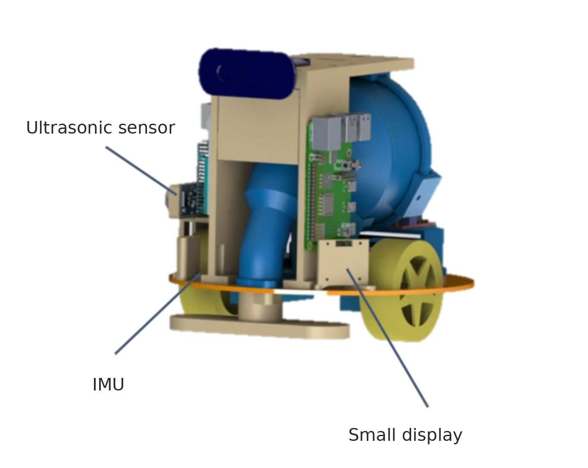
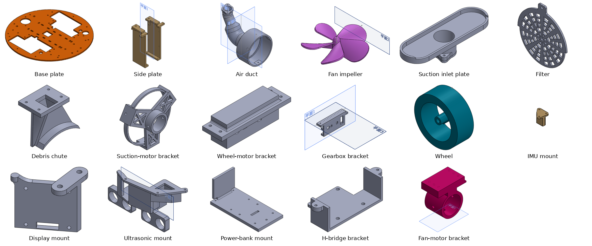

# Remote-Control Vacuum Cleaning Robot (CAD)

This is the SolidWorks design of a teleoperated vacuum-cleaning robot. It was the project for the *Mechatronics* course at National Taiwan University (Sep 2023 - Feb 2024). I was the project leader and modeled the whole robot around the vacuum module.

The full animation is `video/robot_car_new_animation.mp4`. More renders are in `images/render_*.jpg`.

## Two versions

| | First version (Oct 2023) | Final version (Jan 2024) |
|---|---|---|
| Frame | Two stacked round plates on standoffs | Round base plate with vertical side plates |
| Vacuum path | Inlet ring → air duct → fan | Suction inlet plate → debris chute → filter → fan impeller and housing → air duct |
| Drive | Wheel modules on motor brackets | Gear-motor drive with left / right gearbox brackets |
| Sensors and electronics | HC-SR04, Logitech C270, Raspberry Pi 4, Arduino UNO + L298N | Adds an IMU, a small display, front ultrasonic sensor mounts, a power-bank mount and an H-bridge bracket |

## CFD-driven nozzle iteration

I iterated the suction-nozzle geometry in SolidWorks Flow Simulation. The final design raised **suction power by 23%** and the **effective cleaning area by 52%**. The Flow Simulation project files are not included here. The successive suction inlet plates (`suction_inlet_plate` to `_new4`) and fan impellers are all in `cad/parts/` and `stl/`.

## Parts I designed (final version)

| Folder | Contents |
|---|---|
| `cad/assemblies/` | `robot_car_new.SLDASM` (final), `robot_car.SLDASM` (earlier), `wheel_assembly.SLDASM`, `assembly1.SLDASM` |
| `cad/parts/` | 45 parts, including every design iteration (`_old`, `_new`, `_new2`, `_v2`, ...) |
| `stl/` | 3D-printing exports of the printed parts |
| `dxf/` | Laser-cutting files for the top and base plates |
| `archive/v1_2023-10/` | The October 2023 snapshot that this repository first published |
| `code/` | My Arduino servo test (pyFirmata) |
| `FILE_MAP.csv` | Original Chinese file name → English name for every file |

### Opening the assemblies

The files were renamed from Chinese to English after the project. SolidWorks stores part references by file name, so when you open an assembly here it will report missing parts. Point each missing reference to the English file listed in `FILE_MAP.csv`.

`ball_caster_v2.SLDPRT` (originally 新剁倫) is a flat four-hole plate, not a caster.

## Not included

- **Third-party component models** (Raspberry Pi 4, Arduino UNO, L298N, SG90, HC-SR04, Logitech C270) came from online CAD libraries and are not redistributed here. You can download them from GrabCAD or the vendors.
- **The robot software** (teleoperation and the phone app) was written by teammates and is not part of this repo.

## Credits

- CAD models, 3D-print and laser-cut files, and CFD iteration: Kai-Chun Chang (project leader, Mechatronics course team project).
- The English file names, this README, the labeled image, the GIF and the part previews were prepared in October 2026 with help from an AI assistant (Claude). The CAD files themselves are the 2023-2024 originals, renamed only.
